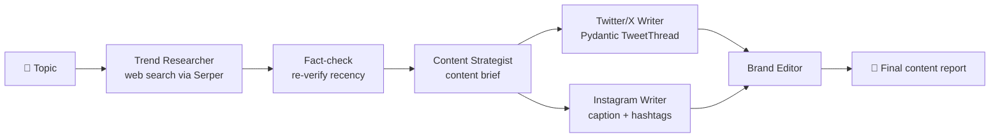

# 📰 AI Content Research Crew

**Give it a topic. Five AI agents research it on the web, fact-check it, and turn it into ready-to-post social media content.**

A sequential multi-agent pipeline built with **CrewAI**. A researcher searches the web and then re-checks its own findings for accuracy, a strategist writes a content brief, two writers produce a Twitter/X thread and an Instagram caption, and an editor rewrites both before publishing.

Built to apply what I learned in DeepLearning.AI's *Multi AI Agent Systems with crewAI* course.

---

## How it works



| Step | Agent | Output |
|---|---|---|
| 1. Research | Trend Researcher | 3–4 findings with sources, found through web search |
| 2. Fact-check | Trend Researcher | Only findings confirmed to be current and accurate |
| 3. Strategy | Content Strategist | Core message, audience and angle |
| 4. Twitter/X | Twitter/X Writer | Thread validated as a list of separate tweets |
| 5. Instagram | Instagram Writer | Caption, visual concept and hashtags |
| 6. Edit | Brand Editor | Improved versions of both, plus a list of edits |

---

## What it demonstrates

- **Tool use:** the researcher uses `SerperDevTool` (Google Search API) to get current information instead of relying on model memory.
- **Self-correction loop:** a dedicated fact-check task re-searches outdated statistics before anything is written.
- **Task chaining with `context`:** each task receives exactly the outputs it needs, including a fan-in where the editor reviews both posts at once.
- **Structured output:** `output_pydantic=TweetThread` forces the thread into a list of individual tweets plus hashtags, instead of one block of text.
- **Reliable execution:** `allow_delegation=False` on every agent stopped agents from handing work to each other, which had been multiplying API calls and causing rate-limit errors.

## Project evolution

| Version | What it does |
|---|---|
| [`notebooks/01_basic_content_crew.ipynb`](notebooks/01_basic_content_crew.ipynb) | Starting point: a 3-agent planner → writer → editor crew that writes a blog post, run in Colab with Gemini |
| [`content_crew.py`](content_crew.py) | Extended version: 5 agents, 6 tasks, web search, fact-checking, structured tweet output and a stricter editor |

---

## Getting started

```bash
git clone https://github.com/ala-alduais/ai-content-research-crew.git
cd ai-content-research-crew

python -m venv venv
source venv/bin/activate        # Windows: venv\Scripts\activate
pip install -r requirements.txt

cp .env.example .env            # add your Gemini and Serper API keys
python content_crew.py
```

To change the topic, set `TOPIC` in `.env`. The final content is printed and saved to `output/final_content.md`.

| Variable | Purpose |
|---|---|
| `GOOGLE_API_KEY` | Gemini API key |
| `SERPER_API_KEY` | Serper.dev key for web search |
| `MODEL` | LLM to use (default `gemini/gemini-3.6-flash`) |
| `TOPIC` | Topic to research |

## Tech stack

Python · CrewAI · Gemini API · Serper (Google Search API) · Pydantic

---

## Author

**Ala Al-Duais** · [GitHub](https://github.com/ala-alduais)
